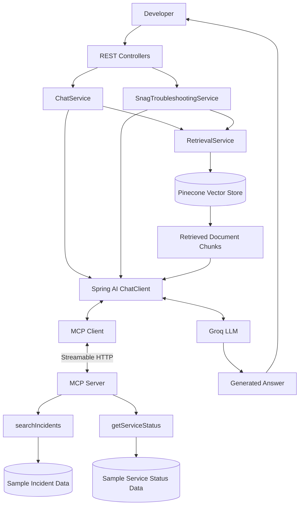
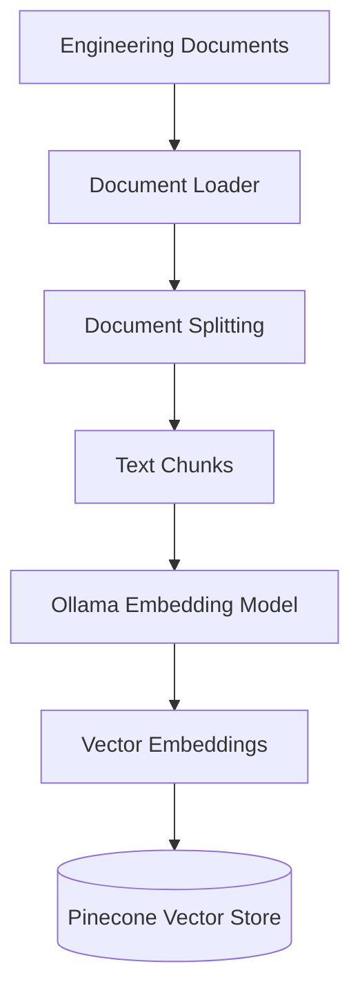
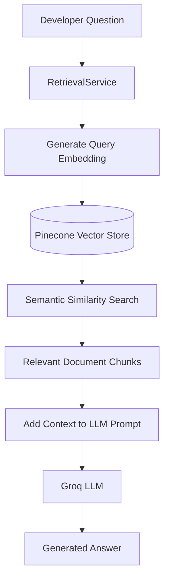
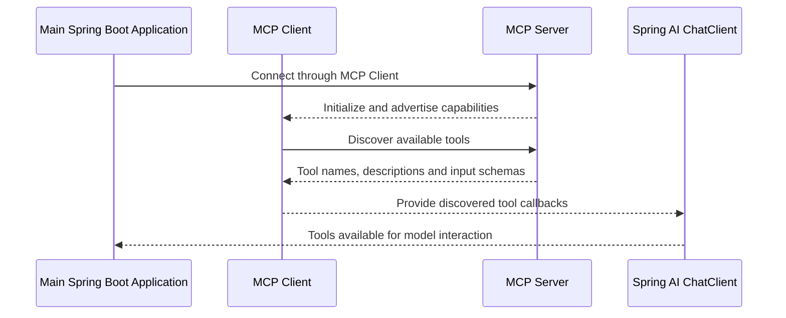
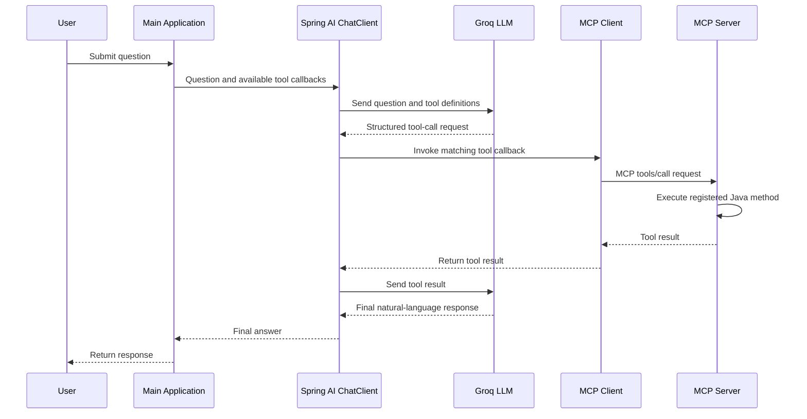

# Nexora AI Knowledge Hub – Architecture

## 1. Architecture Overview

Nexora AI Knowledge Hub consists of two independent Spring Boot applications:

1. **Main Application (MCP Host):** Handles REST APIs, document retrieval, LLM communication, and MCP Client integration.
2. **MCP Server:** Exposes external tools that the AI application can discover and invoke.

The main application uses Spring AI to coordinate interactions with the LLM and discovered MCP tools.

## 2. High-Level Architecture



The diagram represents the logical architecture. Actual request processing and tool invocation are coordinated by Spring AI in the main application.

## 3. Application Components

### 3.1 Main Application – MCP Host

The main Spring Boot application acts as the MCP Host.

Its responsibilities include:

- Accepting developer requests through REST APIs.
- Managing the RAG retrieval workflow.
- Interacting with the LLM through Spring AI.
- Hosting the MCP Client integration.
- Coordinating tool invocation and response generation.

Important components:

| Component | Responsibility |
|---|---|
| ChatController | Handles general engineering questions. |
| SnagController | Handles technical troubleshooting requests. |
| ChatService | Coordinates RAG context and LLM interaction. |
| SnagTroubleshootingService | Generates structured troubleshooting responses. |
| RetrievalService | Retrieves relevant document chunks from Pinecone. |
| Spring AI ChatClient | Coordinates communication with the LLM and tool callbacks. |
| MCP Client | Communicates with the separate MCP Server. |

### 3.2 MCP Server

The MCP Server is a separate Spring Boot application.

It exposes tools using Spring AI MCP Server capabilities.

Currently, it exposes two tools:

**searchIncidents**

- Accepts a keyword.
- Searches sample historical incident records.
- Returns matching incidents, including their causes and resolutions.

**getServiceStatus**

- Accepts a service name.
- Looks up the corresponding status.
- Returns values such as UP, DEGRADED, or UNKNOWN.

The current implementation uses in-memory sample data. It does not connect to a production incident database or live monitoring system.

## 4. RAG Architecture

Retrieval-Augmented Generation allows the application to provide relevant engineering documentation to an LLM when answering a question.

### 4.1 Document Ingestion Flow



Steps:

1. Engineering documents are loaded through the internal ingestion pipeline.
2. Documents are split into smaller chunks using a text splitter.
3. Ollama generates vector embeddings using the Nomic Embed Text model.
4. The document chunks and their embeddings are stored in Pinecone.

### 4.2 Query and Retrieval Flow



Steps:

1. The developer submits a question.
2. The RetrievalService uses the embedding model to represent the query as a vector.
3. Pinecone searches for semantically similar document chunks.
4. Relevant chunks are returned to the application.
5. The retrieved content is included in the LLM prompt.
6. Groq generates an answer using the supplied context.

The application uses retrieved documentation to ground its answers rather than relying only on the LLM's general knowledge.

## 5. MCP Architecture

Model Context Protocol provides a standardized way for an AI application to discover and invoke external capabilities.

### 5.1 MCP Components

| Component | Responsibility |
|---|---|
| MCP Host | The main AI application that manages the overall interaction. |
| MCP Client | Connects to an MCP Server and discovers and invokes its capabilities. |
| MCP Server | Exposes tools, resources, and prompts through the MCP protocol. |
| LLM | Determines when a tool is useful and generates the final response. |

In this project:

- Main Spring Boot application acts as the MCP Host.
- Spring AI provides the AI orchestration framework.
- MCP Client integration runs inside the main application.
- The separate `nexora-mcp-server` application acts as the MCP Server.
- Groq provides the LLM.

### 5.2 MCP Tool Discovery Flow



Tool discovery happens when the MCP connection is established and initialized, rather than requiring the developer to manually register every tool in the main application.

### 5.3 MCP Tool Invocation Flow



Important details:

1. The MCP Client discovers the tools exposed by the MCP Server.
2. Spring AI makes the discovered tool callbacks available to the ChatClient.
3. The LLM receives tool definitions along with the user's question.
4. The LLM decides whether to request a tool invocation.
5. Spring AI processes the tool-call response and routes it through the corresponding callback.
6. The MCP Client sends the invocation to the MCP Server.
7. The MCP Server resolves and executes the registered Java method.
8. The result travels back through the MCP Client and Spring AI.
9. Spring AI sends the tool result to the LLM for final response generation.

The LLM does not directly communicate with the MCP Server. Spring AI coordinates the interaction.

## 6. Combined RAG and MCP Workflow

Nexora combines document retrieval and external tool invocation to support technical investigation.

For example, when a developer asks:

"What could cause Payment API errors, and what happened in similar past incidents?"

The application can:

1. Retrieve relevant documentation chunks from Pinecone.
2. Supply the retrieved documentation as context to the LLM.
3. Make the `searchIncidents` MCP tool available.
4. Allow the LLM to request historical incident information.
5. Receive the incident search results through the MCP Client.
6. Provide the retrieved documentation and tool results to the LLM.
7. Generate a response combining both sources.

The exact tools used depend on the question and the LLM's tool-selection decision.

## 7. Communication Between Applications

The main application and MCP Server run as separate Spring Boot processes.

| Application | Port | Role |
|---|---:|---|
| SpringManualTest | 8080 | Main application and MCP Host |
| nexora-mcp-server | 8090 | MCP Server |

The MCP Client connects to the MCP Server using Streamable HTTP.

The main application uses the configured MCP Server URL:

```properties
spring.ai.mcp.client.streamable-http.connections.nexora-mcp-server.url=http://localhost:8090
```

## 8. Architecture Design Decisions

### Separate MCP Server

The MCP Server is maintained as a separate application so that its tools can be exposed independently of the main AI application.

### RAG for Engineering Documentation

RAG allows the application to retrieve relevant documentation at query time instead of including all engineering documents in every LLM request.

### Vector Database

Pinecone stores document embeddings and supports semantic similarity search.

### Local Embedding Generation

Ollama generates document and query embeddings locally using Nomic Embed Text.

### LLM Inference

Groq provides the LLM inference endpoint, integrated through Spring AI's OpenAI-compatible model support.

### Standardized Tool Integration

MCP provides a standardized protocol for discovering and invoking external capabilities without requiring the main application to implement a separate custom communication mechanism for every tool server.

## 9. Current Architecture Limitations

- The MCP Server currently uses sample in-memory incident and service-status data.
- Service status is not retrieved from actual infrastructure monitoring.
- Document ingestion is an internal pipeline and is not exposed as a REST API.
- The application depends on the availability of external services such as Pinecone and Groq.
- Generated answers require evaluation and testing; RAG does not guarantee correctness.